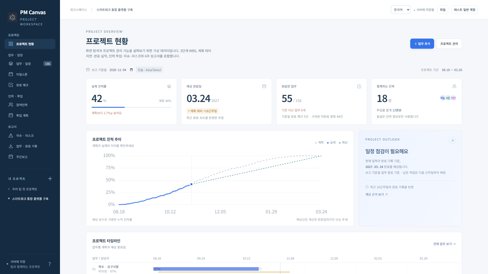

# PM Canvas

Plan tasks, record completions, and review project progress and forecast finish dates.

Teams share a self-hosted web workspace; individuals work offline on Windows, macOS, iPhone or Android.

Connect WBS, Gantt schedules, staffing and weekly reports, with Excel and project-file import/export.

[Product scope and priorities](docs/product-scope.md) · [한국어](README.md)

| Directory                     | Purpose                                               |
| ----------------------------- | ----------------------------------------------------- |
| [web/](web/README.en.md)      | Self-hosted Node.js and PostgreSQL web application    |
| [desktop/](desktop/README.md) | Offline Windows and macOS application                 |
| [mobile/](mobile/README.md)   | Offline iPhone and Android application with Capacitor |
| [shared/](shared/README.md)   | Shared calculations, validation, and reusable UI      |
| .github/                      | Product-specific CI and desktop packaging             |

Install dependencies inside each product. The root package only forwards development commands. Existing web configuration, keys, backups, documentation and operational scripts now live under `web/`. Run web administration commands there. The Compose project keeps the existing default name `pmcanvas`.

Development and operations: [product identity rules](docs/product-identity.md) · [local workspace maintenance](docs/workspace-maintenance.md). The root package version `0.1.0` is development metadata; each product has its own release version in its `package.json`.

See the product READMEs for development, testing and packaging. Verification records describe the environment and checks for each release; older results do not establish coverage for current versions. Certificate-backed signing, notarization and installer lifecycle checks are recorded separately; see [signing setup](desktop/SIGNING.md). Existing web installations should follow the [data-preserving upgrade instructions](web/docs/DEPLOYMENT.md).
