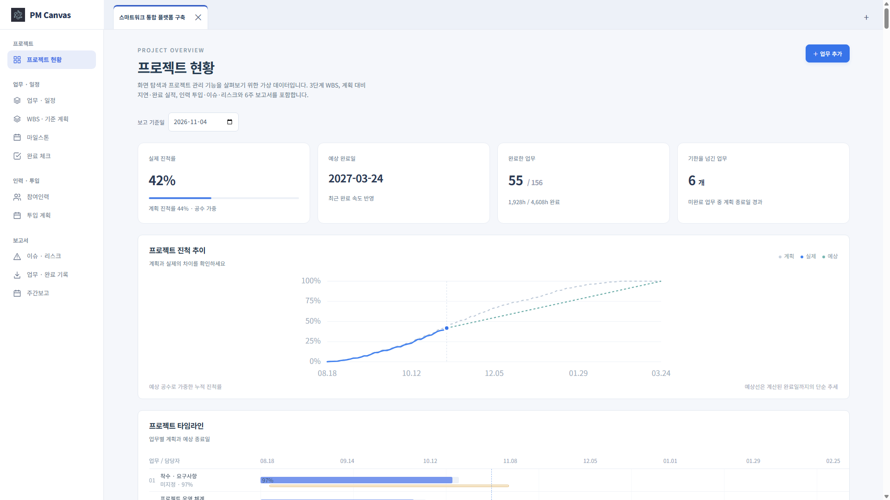
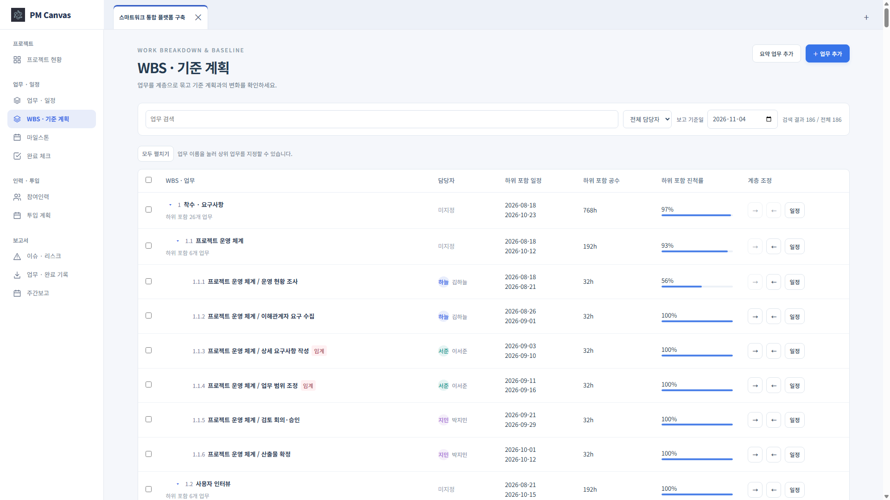
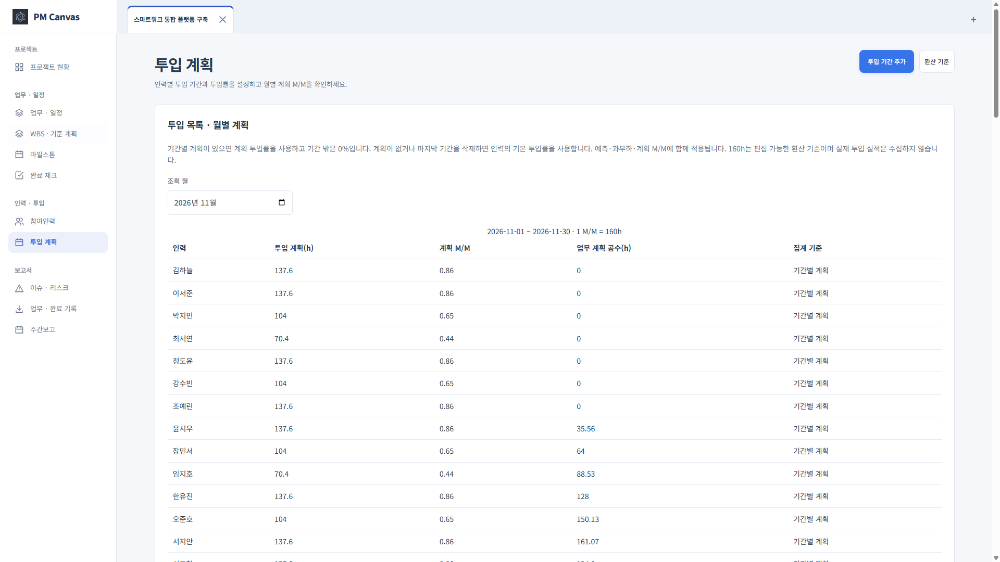
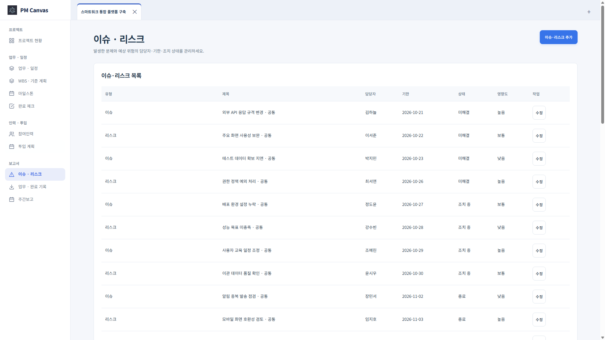
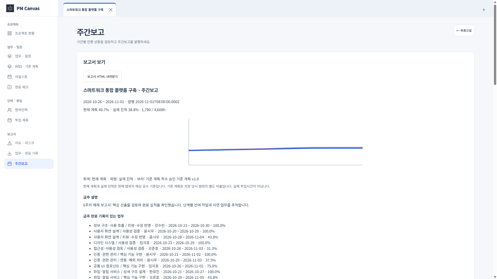
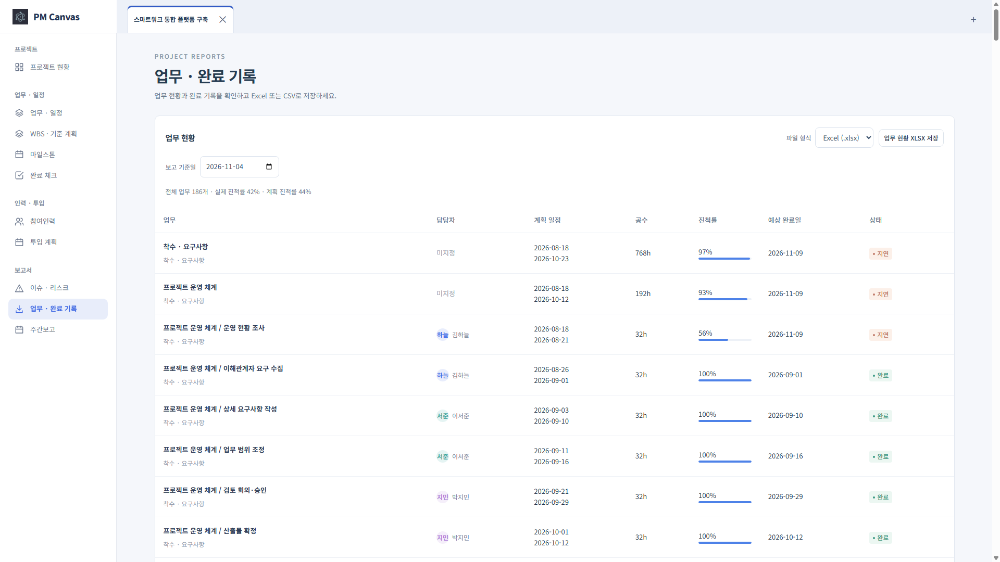

# PM Canvas 데스크톱 1.9.0 사용 매뉴얼

Windows Microsoft Store 제출 버전과 같은 소스의 화면입니다. 기존 버전에서 달라진 점은 여러 프로젝트 탭, 프로젝트와 앱 설정 분리, 웹과 공통인 그래프, 휴일 설정, 최소 12px 글자입니다. [버전 목록](../../README.md)

## 1. 프로젝트 만들기와 파일 열기

상단 **＋** 또는 파일 메뉴에서 새 프로젝트를 만듭니다. 이름을 입력한 뒤 참여인력과 업무를 추가하세요. 기존 `.pmcanvas`는 **파일 → 열기**로 열며 여러 파일을 각각의 탭으로 사용할 수 있습니다. 상단 탭으로 전환하고 탭의 닫기 버튼으로 정리합니다. 수정 표시가 있으면 **Ctrl+S**로 저장합니다.

프로젝트는 설치 폴더 밖에 보관하세요. 입력한 변경은 복구 사본에도 보관하지만 공유·이동용 파일은 직접 저장해야 합니다. 종료할 때 미저장 탭의 안내를 확인합니다. 다른 프로그램에서 바뀐 파일은 덮어쓰지 않고 다른 이름으로 저장할 수 있습니다.

## 2. 프로젝트 현황과 그래프

왼쪽 **프로젝트 현황**에서 보고 기준일을 선택합니다. 실제 진척률은 완료된 세부 작업의 예상 공수로 가중합니다. 예상 완료일은 계획·가용 시간·완료 기록에 따른 추정이며 확정 납기일이 아닙니다.

진척 추이는 계획·실제·예상을 비교하고, 아래 타임라인은 업무별 계획과 예상 기간을 표시합니다. 인력별 진척에서 담당자별 완료 비율을 확인합니다. 담당자가 없는 미완료 업무는 예상일을 계산하지 못할 수 있습니다.

## 3. 업무·WBS·기준 계획

**업무 · 일정**에서 업무명·담당자·시작/종료일·세부 작업을 편집합니다. 세부 작업에는 예상 공수를 넣습니다. 상위 업무는 요약용이며 공수·진척률·기간은 하위 업무에서 집계됩니다.

**WBS · 기준 계획**에서 상위 업무, 들여쓰기/내어쓰기, 순서 이동·복제·삭제와 접기를 사용합니다. 선택한 업무의 일정은 미리보기로 확인한 뒤 적용합니다. 기준 계획을 저장하면 이후 일정과 공수 변경을 비교할 수 있습니다. 선행 관계는 순환하지 않게 연결합니다. 임계 업무·선행 충돌·인력 과부하도 함께 점검하세요.

## 4. 인력·투입 계획·마일스톤

**참여인력**에서 역할·등급·하루 근무시간·기본 투입률을 입력합니다. **투입 계획**에서 기간별 투입률과 월별 계획 M/M을 확인합니다. 기간별 계획이 있으면 그 계획을 사용하고 계획 밖 기간은 가용 시간이 0입니다. 1 M/M 기준 시간은 환산 기준 화면에서 변경합니다. M/M은 계획치이며 실제 근무시간 실적이 아닙니다.

**마일스톤**은 공수를 소모하지 않는 승인·완료 시점입니다. 목표일과 실제 완료일, 담당자·선행 업무를 지정합니다. 프로젝트 설정의 한국 공휴일 자동 반영과 직접 등록한 휴무일은 예측·투입 계산에 함께 사용됩니다. **앱 설정 → 휴일**에서 자동 달력 갱신을 확인합니다.

## 5. 완료 체크와 이슈·리스크

**완료 체크**에서 기준일을 선택하고 완료한 항목을 체크합니다. 체크를 취소하면 완료일도 취소됩니다. 미래의 완료일은 입력할 수 없습니다. 변경을 되돌려야 하면 실행 취소·다시 실행을 사용합니다.

**이슈 · 리스크**에서 목록·추가·수정 화면을 사용합니다. 유형, 영향도, 리스크 발생 가능성, 담당자, 기한, 관련 업무와 조치 내용을 관리합니다.

## 6. 주간보고와 파일 출력

**주간보고 → 주간보고 작성**에서 기간과 금주/차주 설명을 입력하고 미리보기를 확인한 뒤 발행합니다. 발행한 보고서는 그 시점의 수치와 내용을 보존합니다. 일반 편집으로 수정·삭제하지 않으며 정정이 필요하면 새 보고서를 발행합니다. **보기 → 보고서 HTML 내려받기**로 저장합니다.

**업무 · 완료 기록**에서 업무 현황과 완료 기록을 Excel 또는 CSV로 저장합니다. 완료 기록은 기간·담당자로 조회하며 실제 근무시간 합계가 아닌 완료 항목의 예상 공수입니다.

Excel 입력 양식에 데이터를 작성하고 가져오기에서 시트·열 연결·오류 미리보기를 확인하세요. 새 업무 추가 또는 업무 ID 기준 갱신 후 적용합니다. `.pmcanvas`는 웹·모바일과 공유할 수 있으며 버전 3 파일의 관리 데이터는 이를 지원하는 앱에서 열어야 합니다.

## 7. 설정·업데이트·백업

왼쪽 프로젝트 메뉴와 **앱 설정**은 별도 영역입니다. 앱 설정에서는 언어, 업무 기준 시간대, 공휴일 갱신, 업데이트와 앱 정보를 관리합니다. 시간대를 바꾸기 전에 입력을 저장하거나 취소하세요.

Microsoft Store 버전의 업데이트는 Store에서 진행합니다. 로그인·팀 공유·서버 관리가 필요하면 웹을 사용합니다. 다른 기기로 옮기기 전 `.pmcanvas`를 저장하고 별도 위치에 백업하세요.
