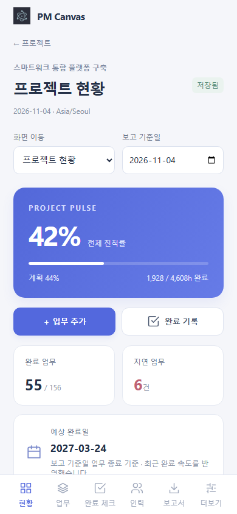
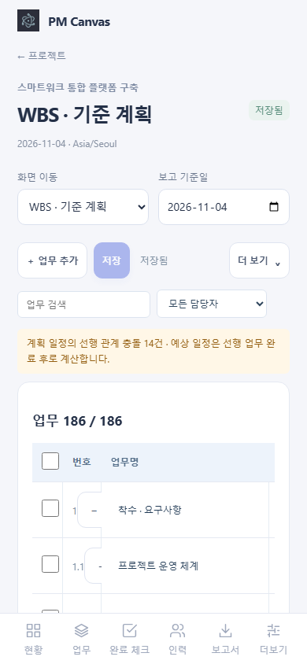
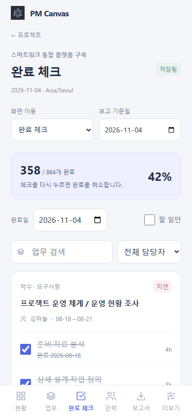
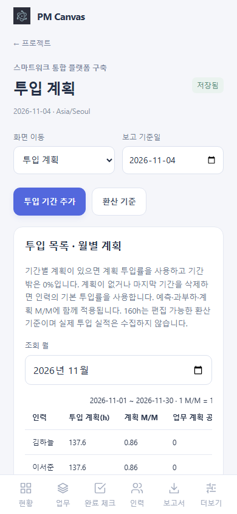
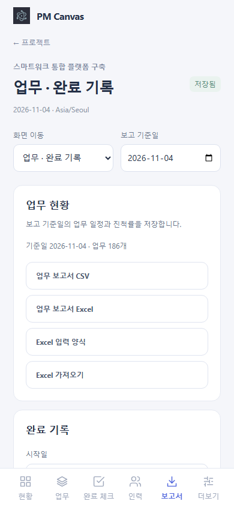

# PM Canvas 모바일 0.2.0 사용 매뉴얼

iPhone·Android용 오프라인 앱의 현재 소스·개발 빌드를 기준으로 합니다. 이 문서의 이미지는 휴대폰 크기 브라우저로 확인한 화면이며 실기기 Store 심사 캡처를 대신하지 않습니다. [버전 목록](../../README.md)

## 1. 시작과 화면 이동

프로젝트 목록에서 **새 프로젝트**를 만들거나 `.pmcanvas`를 가져옵니다. 가져오기는 기존 데이터를 덮어쓰지 않고 사본을 만듭니다. 하단은 현황·업무·완료 체크·인력·보고서·더보기로 이동하며, 상단 **화면 이동** 선택기에서 WBS·마일스톤·투입 계획·이슈·주간보고도 직접 엽니다.

데이터는 기기에 보관하며 서버 계정은 필요하지 않습니다. 보고 기준일을 바꾸면 그 날짜의 실제·계획 진척을 조회합니다. 그래프와 일정은 가로로 밀어 전체 기간을 확인할 수 있습니다.

## 2. 업무·WBS·완료 체크

업무 이름을 입력하고 필요하면 담당자·일정·세부 작업과 공수를 추가합니다. 참여인력은 인력 탭에서 등록합니다. WBS에서는 표 편집·붙여넣기·계층·기준 계획·선행 관계·일정 조정을 사용합니다. WBS 변경은 **저장**을 눌러야 확정되며 미저장 상태에서는 이동을 막아 입력을 보호합니다.

완료 체크에서 완료일을 선택해 항목을 체크합니다. 완료를 잘못 기록했으면 되돌리기나 더보기의 실행 취소를 사용합니다. 필터 초기화로 숨겨진 업무를 다시 표시할 수 있습니다.

## 3. 프로젝트 관리

마일스톤은 공수를 쓰지 않는 승인 시점입니다. 투입 계획에서 인력·기간·투입률과 M/M 기준 시간을 설정합니다. 이슈·리스크는 영향도·가능성·담당자·기한·조치를 관리합니다. 주간보고는 미리보기를 확인한 뒤 발행하고 HTML로 저장합니다.

## 4. 보고서·Excel·파일 공유

보고서에서 업무 현황과 기간·담당자별 완료 기록을 Excel·CSV로 저장합니다. Excel 입력 양식과 열 연결·오류 미리보기 가져오기도 지원합니다. 가져온 업무는 WBS 초안에 적용한 뒤 저장합니다.

더보기에서 프로젝트 파일을 내보내면 네이티브 앱은 OS 공유 시트를 엽니다. 브라우저 미리보기는 다운로드로 동작합니다. 웹·데스크톱과는 파일로 이동하며 서버 로그인·팀 공유·자동 동기화는 웹에서 사용합니다.

앱 삭제·기기 저장소 정리 전에 파일을 별도 보관하세요. 시간대를 바꾸기 전 입력을 저장하거나 취소하고, 저장된 완료일이 새 시간대의 미래가 되는 변경은 허용되지 않습니다.
