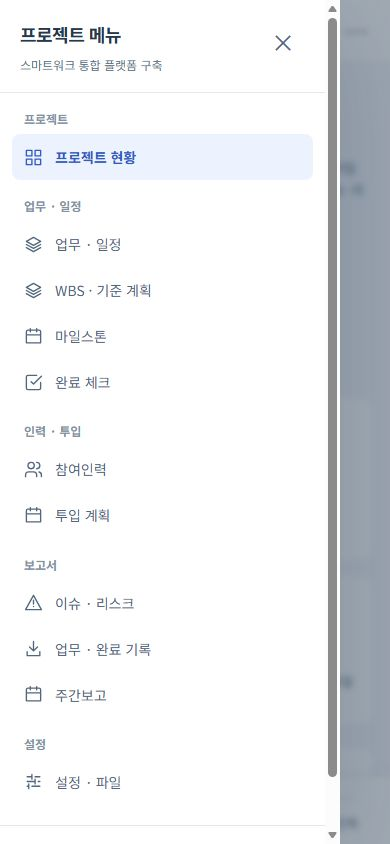
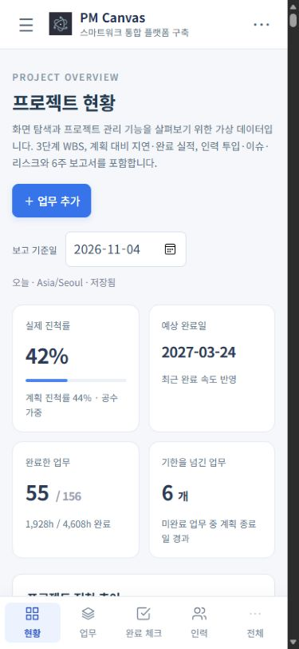
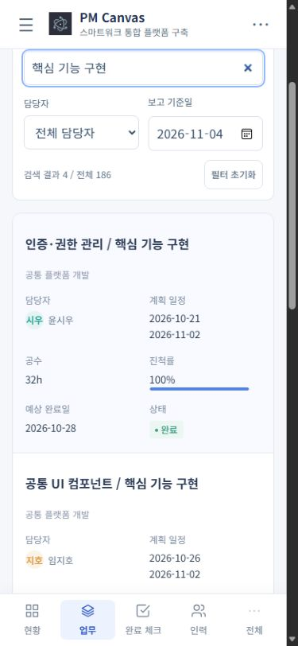
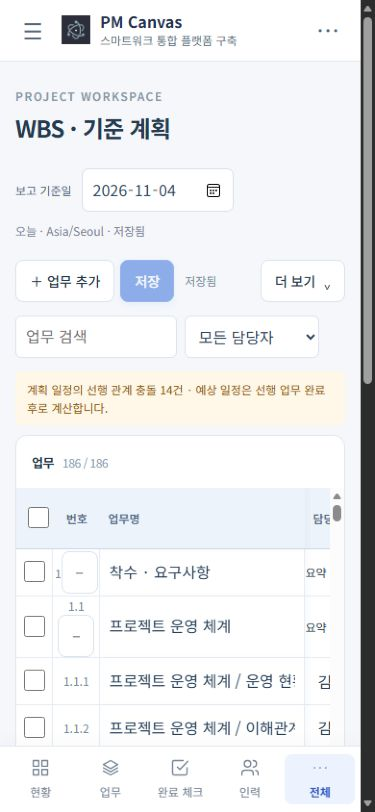
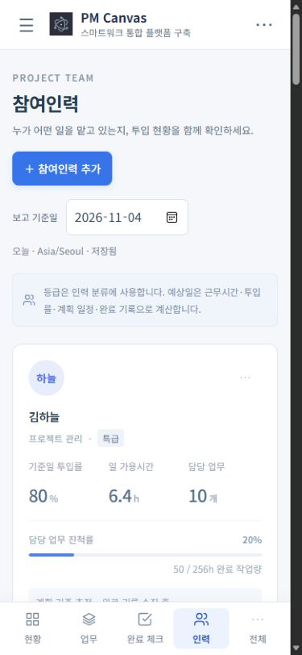
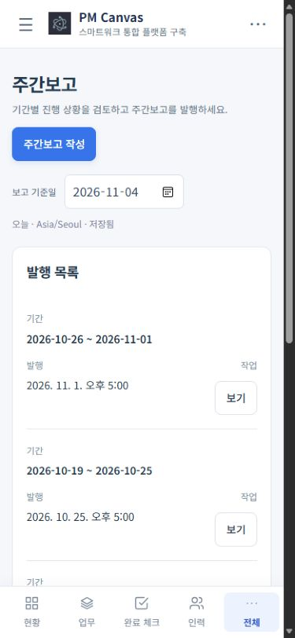

# PM Canvas 모바일 0.3.0 사용 매뉴얼

데스크톱의 프로젝트 관리 화면을 휴대폰·태블릿에 맞게 배치한 오프라인 앱입니다. 현황·업무·완료 체크·인력 화면과 휴무일 달력은 데스크톱과 같은 화면 코드를 사용합니다. 계산·WBS·보고서·파일 형식은 기존 프로젝트와 호환됩니다.

## 화면 이동

상단 메뉴 버튼 또는 하단 **전체**에서 모든 화면을 엽니다. 그룹과 순서는 데스크톱과 같습니다. 하단의 현황·업무·완료 체크·인력은 바로 가기이며, 전체 메뉴에도 같은 위치가 표시됩니다. 상단 프로젝트 이름을 누르면 저장된 프로젝트 목록으로 돌아갑니다. 화면마다 제목을 한 번만 표시하고, 보고 기준일은 해당 화면의 작업 도구에 배치했습니다.

| 그룹        | 화면                                              |
| ----------- | ------------------------------------------------- |
| 프로젝트    | 프로젝트 현황                                     |
| 업무 · 일정 | 업무 · 일정, WBS · 기준 계획, 마일스톤, 완료 체크 |
| 인력 · 투입 | 참여인력, 투입 계획                               |
| 보고서      | 이슈 · 리스크, 업무 · 완료 기록, 주간보고         |
| 설정        | 설정 · 파일                                       |

## 현황과 업무

실제 진척률·계획 진척률, 예상 완료일, 완료 업무와 지연 업무를 함께 확인합니다. 진척 추이·타임라인·인력별 그래프와 업무 진행 현황을 제공합니다. 보고 기준일을 바꾸면 같은 날짜 기준으로 계산합니다.

업무 화면은 데스크톱과 같은 업무·담당자·계획 일정·공수·진척률·예상 완료일·상태를 표시합니다. 휴대폰에서는 표의 각 행을 라벨이 있는 카드로 배치하고, 태블릿에서는 표로 확인합니다. 업무 검색과 담당자 필터를 지원합니다. 업무 이름을 눌러 담당자·일정·세부 작업을 수정하고 추가 설정에서 상위·선행 업무를 지정합니다.

## WBS · 기준 계획

WBS에서 계층·일정·공수·선행 관계를 편집하고 저장합니다. 표 내부를 가로로 이동해 모든 열을 볼 수 있습니다. 더 보기에서 기준 계획·일정 이동·Excel 입력과 출력을 엽니다. 저장하지 않은 입력은 화면 이동을 막고 초안을 유지합니다.

## 인력과 완료 기록

참여인력에서 역할·등급·투입률·일 가용시간·담당 업무 수·담당 진척률을 함께 확인합니다. 인력 카드의 수정 버튼으로 근무시간과 투입률을 편집합니다. 투입 계획은 별도 화면에서 기간과 월별 M/M을 관리합니다. 완료 체크는 보고 기준일을 완료일로 기록하며, 이후에 완료된 항목은 과거 조회에서 변경할 수 없습니다. 할 일만·검색·담당자 필터와 완료 취소를 지원합니다.

## 이슈와 보고서

이슈·리스크, 마일스톤, 투입 계획, 주간보고의 입력과 발행 흐름은 데스크톱과 같습니다. 휴대폰에서는 관리 표도 카드로 배치해 보기·수정 버튼을 화면 안에서 사용할 수 있습니다. 주간보고는 미리보기 후 발행하고 HTML로 내보냅니다. 발행한 보고서의 내용은 이후 업무 변경과 구분해 보관합니다.

업무 · 완료 기록에서 기간·담당자로 조회하고 Excel·CSV로 저장합니다. 상단 파일 메뉴 또는 설정 · 파일에서 프로젝트 설정, 가져오기·내보내기, 실행 취소·다시 실행을 사용합니다. 프로젝트 휴무일은 데스크톱과 공통인 달력에서 선택합니다. 입력 폼은 본문을 스크롤해도 저장·취소가 보이도록 배치했습니다.

## 저장과 설치

변경은 기기에 자동 저장됩니다. WBS는 명시적으로 저장해야 합니다. 기존 0.2.0과 같은 앱 ID와 저장소를 사용하며 `.pmcanvas` 및 프로젝트 JSON을 새 사본으로 가져올 수 있습니다. 다른 기기로 이동할 때는 프로젝트 파일을 내보내 보관합니다. 로그인·팀 공유·서버 동기화·관리자 기능은 웹에서 제공합니다.

Android 개발 APK는 0.3.0, versionCode 3입니다. 앱 삭제는 기기의 프로젝트를 지울 수 있으므로 업데이트 시 기존 앱 위에 설치합니다. 이 안내는 개발 빌드 기준이며 Store 게시를 뜻하지 않습니다.

캡처는 2026-11-04의 가상 프로젝트 **스마트워크 통합 플랫폼 구축**(186개 WBS 업무·18명·6개 주간보고)을 사용한 375–390px 너비의 브라우저 미리보기입니다. 네이티브 Store 제출 캡처를 대신하지 않습니다.
