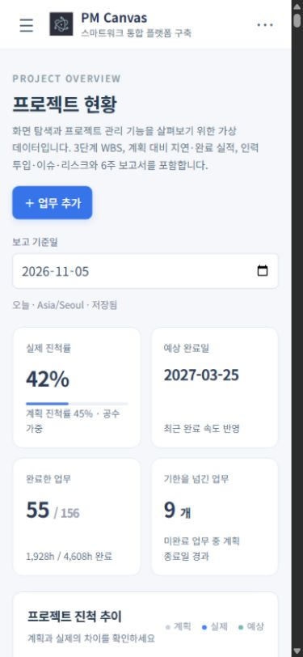
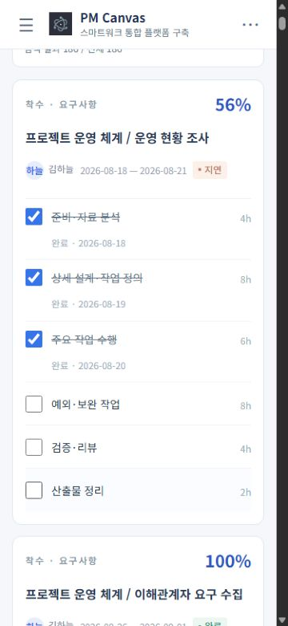
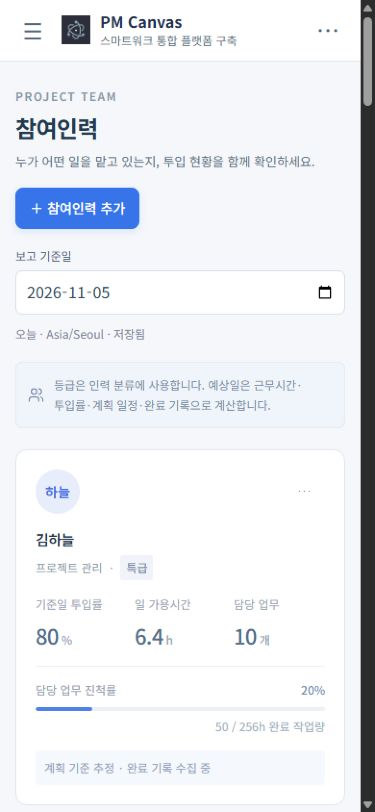

# PM Canvas 모바일 0.3.1 사용 매뉴얼

프로젝트 관리 기능은 [0.3.0 안내](../0.3.0/README.ko.md)와 같습니다. 이번 버전은 작은 화면의 입력·목록·줄바꿈을 정리하고 하단 고정 메뉴를 제거했습니다.

## 화면 이동

상단 왼쪽 메뉴 버튼에서 전체 11개 화면을 엽니다. 프로젝트 이름을 누르면 프로젝트 목록으로 돌아갑니다. 오른쪽 파일 메뉴에서 프로젝트 설정·가져오기·내보내기·실행 취소·다시 실행을 사용합니다.

## 현황과 업무

현황은 진척률·예상 완료일·완료 업무·지연 업무와 세 가지 그래프를 제공합니다. 보고 기준일은 날짜 입력에서 변경합니다. 업무·관리 목록은 760px 이하에서 모든 항목을 보존한 카드로 표시하고 넓은 태블릿에서는 표로 표시합니다.

## 완료 체크와 참여인력

완료율은 분류 옆에 표시하고 업무명에는 카드의 전체 폭을 사용합니다. 완료 기록과 공수 단위는 구분해 표시하며, 실제 완료한 작업을 체크하면 진척률이 반영됩니다. 인력 카드의 이름·역할은 폭에 맞춰 줄바꿈하고 투입률·일 가용시간·업무 수는 같은 행에 정렬합니다.

## 입력과 저장

좁은 입력창에서는 날짜 필드를 한 열로 배치합니다. 세부 작업 이름은 입력 가능한 폭 전체를 사용하고 저장·취소는 폼 본문과 구분합니다. 휴무일 달력은 연·월을 충분한 폭으로 표시합니다. WBS는 가로로 이동해 모든 열을 편집하며 변경 후 저장합니다. 기존 프로젝트 저장소와 파일 형식을 유지합니다.

## 버전과 배포

앱 표시 버전은 **0.3.1**, Android 버전 코드는 **4**입니다. 이 매뉴얼은 해당 소스의 화면과 사용 방법을 설명합니다. Android는 Google Play 프로덕션 제출 대상이며, 심사·게시 상태는 Play Console에서 별도로 확인합니다. iPhone·iPad는 공통 iOS 소스를 사용하며 이 문서는 App Review 제출 완료를 뜻하지 않습니다.

캡처는 2026-11-05의 가상 프로젝트 **스마트워크 통합 플랫폼 구축**(186개 WBS 업무·18명·6개 주간보고)을 사용한 375–390px 브라우저 미리보기입니다. 네이티브 Store 스크린샷과 구분합니다.
