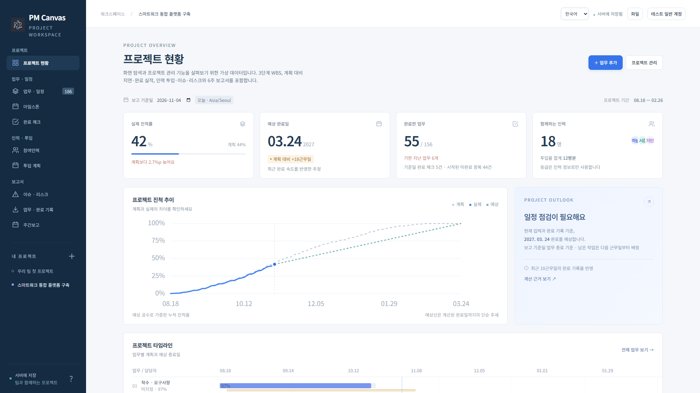
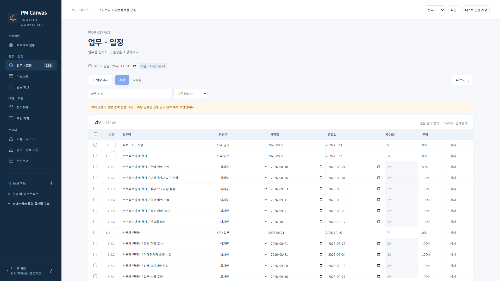
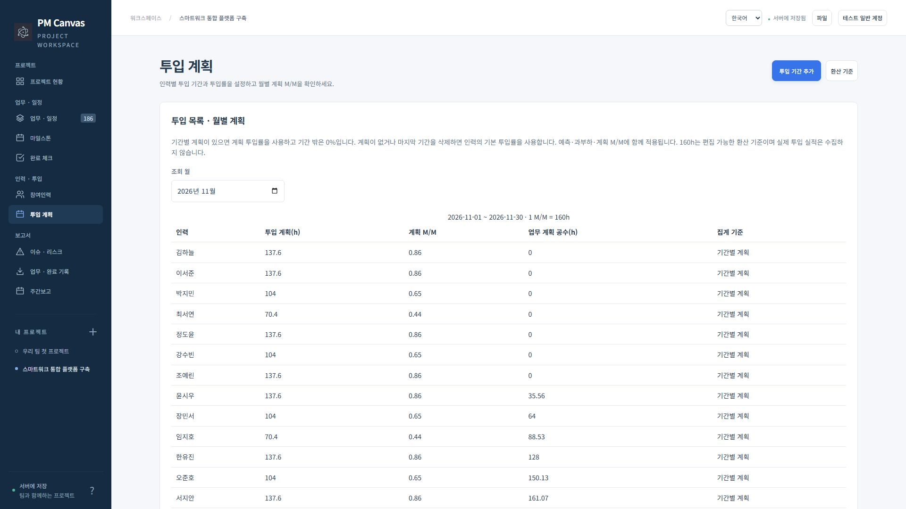
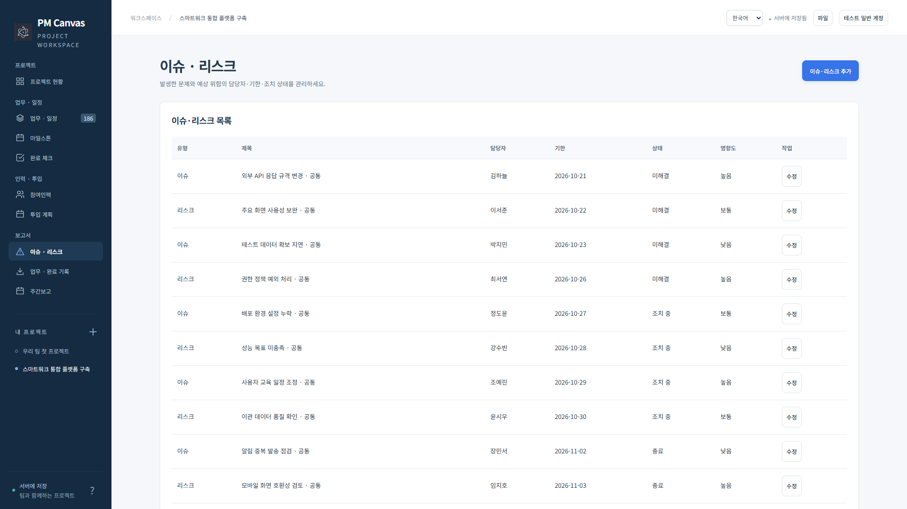
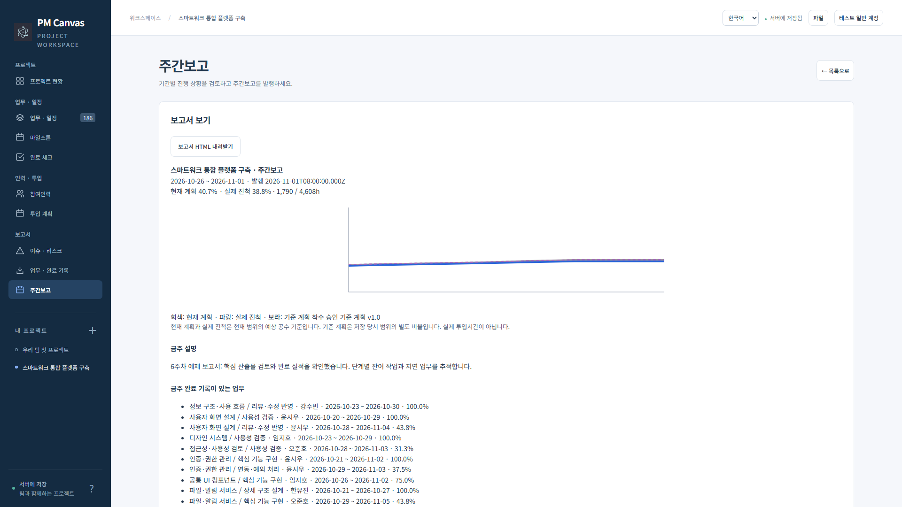
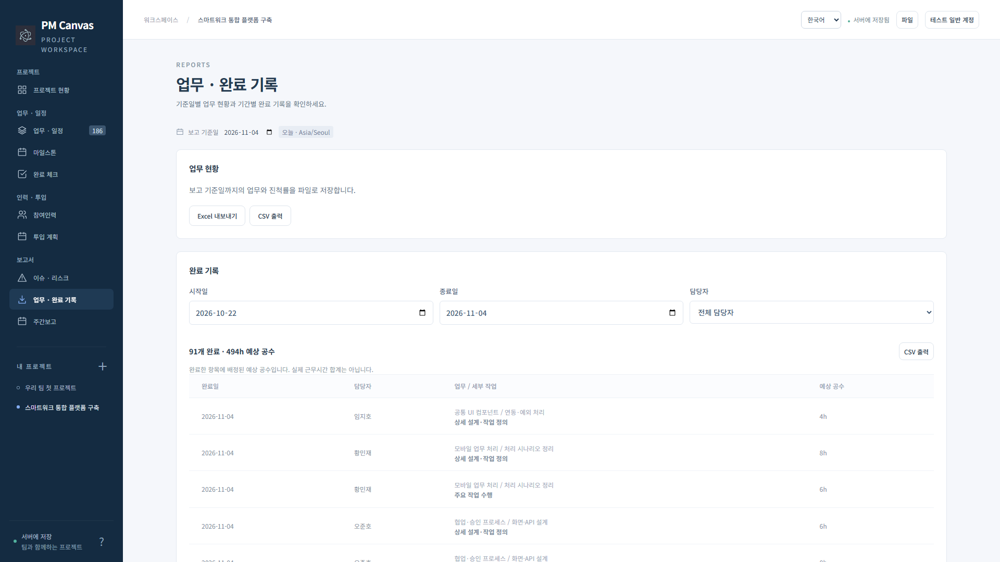

# PM Canvas 웹 0.21.9 사용 매뉴얼

프로젝트 관리와 팀 공유를 제공하는 서버형 앱입니다. 이 문서의 화면은 가상 프로젝트를 사용합니다. [버전 목록](../../README.md)

## 1. 접속·로그인·프로젝트 선택

운영자가 제공한 주소에서 로그인합니다. 관리자 첫 로그인은 인증 앱 MFA 등록이 필요합니다. 회원가입은 이메일 인증과 관리자 승인을 거칠 수 있습니다. SMTP·계정 정책은 관리자가 설정합니다.

왼쪽 **내 프로젝트**에서 프로젝트를 선택합니다. 프로젝트 추가에서 이름·설명을 입력하고 참여인력과 첫 업무를 등록하세요. 작은 화면에서는 화면 이동 선택기를 사용합니다.

## 2. 현황과 계획

**프로젝트 현황**에서 보고 기준일을 고르고 공수 가중 진척률·예상 완료일·지연 업무를 확인합니다. 그래프는 계획·실제·예상 추이, 업무별 타임라인과 인력별 진척을 보여 줍니다.

**업무 · 일정**의 WBS 표는 셀 편집·여러 행 붙여넣기·검색·담당자 필터를 지원합니다. 상위 업무는 요약용이며 하위 업무의 공수·기간·진척을 집계합니다. 더 보기에서 계층·마일스톤·기준 계획·Excel을 사용하고, 간트와 일정 점검에서 선행 충돌·과부하·임계 업무를 확인합니다. 표 입력 후 **저장**을 눌러 서버에 반영합니다.

다른 사용자가 먼저 저장한 경우 비교·선택 후 병합합니다. 입력을 잃지 않도록 초안 백업과 새로 읽기 안내를 따르세요. 보고 기준일의 과거 조회에서는 그 이후 완료 기록을 실제 진척에 포함하지 않습니다.

## 3. 실행과 관리

**완료 체크**에서 항목을 체크해 완료일을 기록합니다. **참여인력**에서 역할·근무시간·투입률을 설정하고 **투입 계획**에서 기간별 계획과 월별 M/M을 관리합니다. 기간 계획의 밖은 가용 시간이 0이므로 필요한 기간을 포함하세요.

**마일스톤**은 승인 시점을, **이슈 · 리스크**는 유형·영향도·가능성·담당자·기한·조치 내용을 관리합니다.

**주간보고**는 기간과 설명을 입력해 미리보기 후 발행합니다. 발행 당시의 내용을 보존하며 정정은 새 보고서로 발행합니다. 보고서 보기에서 HTML을 저장할 수 있습니다.

## 4. 보고서와 파일

**업무 · 완료 기록**에서 기준일별 업무 현황과 기간·담당자별 완료 기록을 조회해 Excel·CSV로 출력합니다. Excel 입력 양식을 작성한 뒤 가져오기에서 열 연결·오류 미리보기를 확인하고 초안에 적용한 다음 WBS를 저장합니다.

파일 메뉴의 JSON/프로젝트 백업은 프로젝트 이동용입니다. 서버 계정·공유·감사 이력 전체를 복구하려면 운영자의 DB 백업과 암호화 키가 필요합니다. 데스크톱·모바일과는 파일로 프로젝트를 이동할 수 있습니다.

## 5. 팀 공유·내 업무·관리자

프로젝트 관리의 공유에서 등록된 계정을 초대하고 소유자·편집자·조회자 역할을 지정합니다. 참여인력과 로그인 계정은 별개이며 **내 업무에 담당 계정 연결**로 연결합니다. **내 업무**에서 여러 프로젝트의 담당 작업을 모아 완료를 기록합니다.

관리자는 계정 메뉴의 사용자·메일·인증·보안·백업을 관리합니다. 로그인·팀 공유·서버 관리 기능은 웹에서 제공하며 오프라인 앱에 자동 동기화되지 않습니다.

설치·Docker·HTTPS·업그레이드는 [운영 설치 안내](../../../../web/docs/DEPLOYMENT.md), 공수·예상일 계산은 [계산 기준](../../../../web/docs/PLANNING.md)을 참고하세요.
